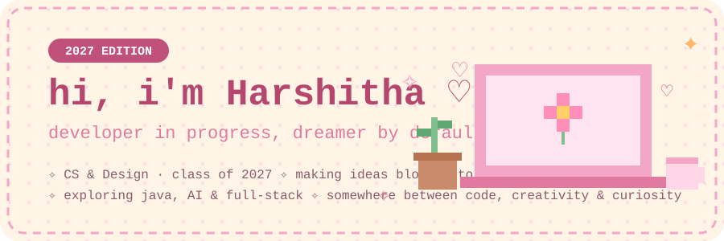
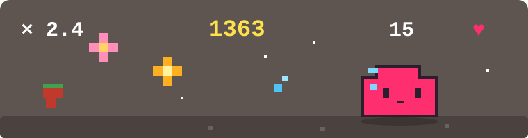

 

✧ take your shoes off, make some chai, and stay a while ✧

  

---

<table>
<tr>
<td width="50%" valign="top">

### 🌷 right now
- 🎀 building a capstone that actually matters
- 🧁 learning full-stack, one tiny feature at a time
- 🌙 poking at AI security and prompt injection
- ☕ powered by chai and curiosity

</td>
<td width="50%" valign="top">

### 🌸 about me
- Computer Science & Design student · class of 2027
- I like software that feels warm, not sterile
- I believe the best projects start with *what if?*
- Pixel art, tiny worlds, and interfaces that feel like a hug

</td>
</tr>
</table>

---

## 🪴 the garden

*a collection of little worlds i've been growing* ♡

<table>
<tr>
<td width="50%" valign="top" bgcolor="#FCE4EE">

#### 🌱 Agro-Plasti-Guard
*environmental intelligence · research*

A microplastic-induced soil vulnerability platform, mixing environmental data, soil health, and geospatial insight.

[→ explore](https://github.com/HarshithaBsrinivas)

</td>
<td width="50%" valign="top" bgcolor="#EDE4FA">

#### 🪴 EcoWardOS
*AI · urban environmental intelligence*

Tree intelligence, environmental assessment, geospatial mapping, and ward-level action tracking in one place.

[→ explore](https://github.com/HarshithaBsrinivas)

</td>
</tr>
<tr>
<td width="50%" valign="top" bgcolor="#FFF0D6">

#### 🧬 OmniOnco
*computational cancer research*

An AI-assisted workflow for exploring cancer datasets, genomic patterns, and reproducible analysis.

[→ explore](https://github.com/HarshithaBsrinivas)

</td>
<td width="50%" valign="top" bgcolor="#FCE4EE">

#### ❤️ Cardio AI Dashboard
*machine learning · healthcare*

A heart-disease risk prediction dashboard built around a classification model.

[→ explore](https://github.com/HarshithaBsrinivas)

</td>
</tr>
<tr>
<td width="50%" valign="top" bgcolor="#E4F4EA">

#### 🏛️ Hampi Chronicles
*interactive heritage storytelling*

A digital story inspired by the history, culture, and heritage of Hampi.

[→ explore](https://github.com/HarshithaBsrinivas)

</td>
<td width="50%" valign="top" bgcolor="#EDE4FA">

#### 📁 File Organizer
*python · automation*

A small utility that tidies messy folders into structured ones.

[→ explore](https://github.com/HarshithaBsrinivas)

</td>
</tr>
<tr>
<td width="50%" valign="top" bgcolor="#FFF0D6">

#### ⚡ CUDA MatrixLab
*parallel computing · CUDA*

GPU-based matrix operations, and a close look at how performance changes.

[→ find it](https://github.com/HarshithaBsrinivas?tab=repositories)

</td>
<td width="50%" valign="top" bgcolor="#E4F4EA">

#### ♻️ ProofCycle
*sustainability · e-waste*

A digital chain-of-custody concept for traceable e-waste management.

[→ find it](https://github.com/HarshithaBsrinivas?tab=repositories)

</td>
</tr>
<tr>
<td width="50%" valign="top" bgcolor="#FCE4EE">

#### ₿ Crypto Project
*cryptography · software*

Exploring secure data handling and the core ideas behind it.

[→ find it](https://github.com/HarshithaBsrinivas?tab=repositories)

</td>
<td width="50%" valign="top" bgcolor="#EDE4FA">

#### 🔐 LLM Prompt-Injection Benchmark
*AI security · research*

Probing how well LLM-based systems hold up against prompt injection.

[→ find it](https://github.com/HarshithaBsrinivas?tab=repositories)

</td>
</tr>
<tr>
<td width="50%" valign="top" bgcolor="#E4F4EA">

#### ✨ What's next?
*more things to create*

</td>
<td></td>
</tr>
</table>

*every project begins with one little question: what if?* ♡

---

## 🎀 little milestones tucked in my pocket

🌎 **NASA Space Apps** · Global Nominee · 2025
🏆 **Smart India Hackathon** · Institute-Level Finalist · 2025
📊 **Best Use of Data** · Internal Recognition · 2025

---

## 🧸 my toolkit

*things i'm learning, using, and growing with*

---

## 📖 a little diary

<table>
<tr>
<td width="100%" bgcolor="#FFF4E6">

> 🌸 *dear future me,*
>
> *you're building things you were scared to start. keep going. every bug is just a plot twist, and every small win counts.* ♡
>
> *— past me, with chai in hand*

</td>
</tr>
</table>

---

## 🌠 dream jar

*little things i'd love to make someday* ✧

🌷 a project that makes someone smile when they open it
🧁 an interface so pretty people screenshot it
🎀 a tool that makes an everyday chore feel magical
🪐 a research paper that changes how someone thinks

---

## 🌸 my coding garden

 

## 🌸 my contribution garden

*(this little snake grows every time i commit)*

---

<b>🔒 the secret garden (click to peek)</b>

 

- 🐰 a bunny is hiding somewhere in this README
- 🍓 favorite snack is whatever is closest to a strawberry
- 🌙 i code best when the house is quiet and the playlist is soft
- 💌 if you found this section, you're officially my favorite visitor today

---

## 💌 find me in little corners of the internet

 

*made with curiosity, creativity & a little magic* ♡

 

