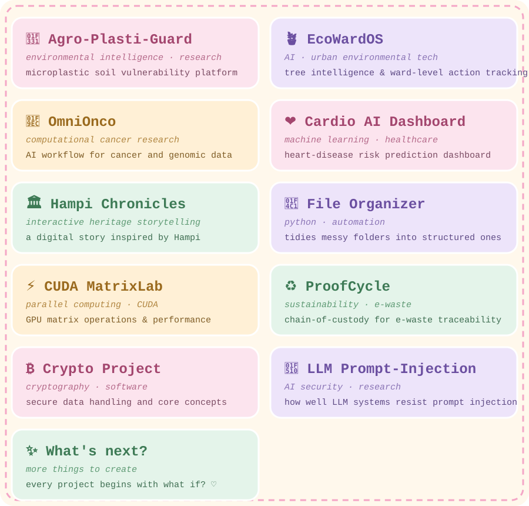

 

✧ take your shoes off, make some chai, and stay a while ✧

  

---

<table>
<tr>
<td width="50%" valign="top">

### 🌷 right now
- 🎀 final-year capstone: an AI-powered cybersecurity digital twin
- 🧁 going deeper into backend and full-stack development
- 🌙 exploring AI security and prompt injection
- ☕ powered by chai and curiosity

</td>
<td width="50%" valign="top">

### 🌸 about me
- Computer Science & Design student · BGSCET · class of 2027
- Backend & full-stack developer, with a UI/UX eye
- Published researcher (IJSREM, 2025)
- I believe the best projects start with *what if?*

</td>
</tr>
</table>

---

## 🪴 the garden

*a collection of little worlds i've been growing* ♡

**explore**

🌱 [Agro-Plasti-Guard](https://github.com/HarshithaBsrinivas/agro-plastic) · 🪴 [EcoWardOS](https://github.com/HarshithaBsrinivas/EcoWardOS) · 🧬 [OmniOnco](https://github.com/HarshithaBsrinivas?tab=repositories) · ❤️ [Cardio AI](https://github.com/HarshithaBsrinivas/cardio_AI) · 🏛️ [Hampi Chronicles](https://github.com/HarshithaBsrinivas/Hampi-chronicles) · 📁 [File Organizer](https://github.com/HarshithaBsrinivas?tab=repositories) · ⚡ [CUDA MatrixLab](https://github.com/HarshithaBsrinivas?tab=repositories) · ♻️ [ProofCycle](https://github.com/HarshithaBsrinivas?tab=repositories) · ₿ [Crypto](https://github.com/HarshithaBsrinivas?tab=repositories) · 🔐 [LLM Benchmark](https://github.com/HarshithaBsrinivas?tab=repositories)

*every project begins with one little question: what if?* ♡

---

## 🌸 a little about my work

<table>
<tr>
<td width="100%" valign="top">

#### 🌷 Web Development Intern · SkillCraft
- Built responsive, cross-browser pages with HTML, CSS, and JavaScript
- Made a stopwatch web app using JavaScript DOM manipulation for live UI updates

</td>
</tr>
</table>

---

## 🎀 little milestones tucked in my pocket

🌎 **NASA Space Apps Challenge** · Global Nominee
🏆 **Smart India Hackathon 2025** · Institute-Level Semifinalist
📄 **Published research** · IJSREM Special Edition, Vol. 09, NCFT 2025
🧠 **AWS AI/ML Scholar** · AWS x Udacity · 2026
📊 **Best Use of Data** · Internal Recognition · 2025

---

## 🧸 my toolkit

*things i'm learning, using, and growing with*

 

**🌷 languages**

 

**🎀 frameworks & backend**

 

**🗄️ databases**

 

**🧁 tools & platforms**

 

**🌸 design**

 

**🌿 core cs**

---

## 🎓 education & certifications

**BE, Computer Science & Design** · BGS College of Engineering and Technology
CGPA 8.67 (till 6th semester) · 2023 – 2027

PUC · RNS Composite PU College · 2023 · 76%
SSLC · New Indian Public School · 2021 · 87%

 

🌸 AWS Cloud Practitioner & AI Fundamentals · Udemy
🌸 IBM Data Analysis with Python
🌸 Cyber Security Foundation · Infosys Springboard
🌸 CCNA · Cisco

---

## 📖 a little diary

<table>
<tr>
<td width="100%" bgcolor="#FFF4E6">

> 🌸 *dear future me,*
>
> *you're building things you were scared to start. keep going. every bug is just a plot twist, and every small win counts.* ♡
>
> *— past me, with chai in hand*

</td>
</tr>
</table>

---

## 🌠 dream jar

*little things i'd love to make someday* ✧

🌷 a project that makes someone smile when they open it
🧁 an interface so pretty people screenshot it
🎀 a tool that makes an everyday chore feel magical
🪐 a research paper that changes how someone thinks

---

## 🌸 my coding garden

*(tap the garden to play ♡)*

 

## 🌸 my contribution garden

*(this little snake grows every time i commit)*

---

<b>🔒 the secret garden (click to peek)</b>

 

- 🐰 a bunny is hiding somewhere in this README
- 🍓 favorite snack is whatever is closest to a strawberry
- 🌙 i code best when the house is quiet and the playlist is soft
- 💌 if you found this section, you're officially my favorite visitor today

---

## 💌 find me in little corners of the internet

 

*made with curiosity, creativity & a little magic* ♡

 

